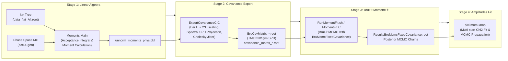

# MomentFit Analysis Workflow

An automated, YAML-configured 3-stage analysis workflow connecting linear algebra moments calculation, covariance regularization, and BruFit MCMC fitting.

---

## 1. Workflow Overview

The MomentFit workflow executes three consecutive stages in order:



1. **Stage 1 (`linear_algebra`)**:
   - Calculates acceptance integral matrices and unnormalized physics moments using the upstream linear algebra library (`/d/grid17/septian/Moments-dev/Moments.Main/`).
   - Automatically adapts input branches:
     - `theta = std::acos(cosTheta_eta_gj)`
     - `phi = phi_eta_gj`
     - `Phi = Phi`
   - Configurable event weight branch (e.g. `weight_branch = "weightASBS"` for nominal data).
   - Exports pickled moments: `unnorm_moments_phys.pkl`.

2. **Stage 2 (`export_covariance`)**:
   - Loads `unnorm_moments_phys.pkl` and scales moments to the physical convention ($\bar{H} = 2 H$).
   - Computes covariance matrices and runs eigenvalue spectral decomposition.
   - Floor small or non-positive eigenvalues ($\lambda_i \ge \lambda_{\min}$) and applies Cholesky test jitter to guarantee Symmetric Positive-Definite (SPD) properties required by BruFit MCMC.
   - Generates per mass bin:
     - `BruCovMatrix_Mpi0eta_%.3f.root`: contains regularized `MyCovMatrix` (`TMatrixDSym`) and `MyCovMatrix_Names` (`TList`).
     - `covariance_matrix_Mpi0eta_%.3f.root`: contains raw moments and initial values `h1_norm_<name>`.

3. **Stage 3 (`moment_fit`)**:
   - Launches BruFit MCMC fits (defaulting to `BruMcmcFixedCovariance` with regularized linear algebra covariance from Stage 2, or optional adaptive `BruMcmcCovariance` via `fixed_covariance: false`).
   - Executes `macros/RunMomentFit.sh` and `macros/MomentFit.C` using system ROOT 6.36 and BruFit, forwarding all YAML-configurable MCMC, frame, acceptance, tuning, and bailout settings via `MOM2AMP_*` environment variables.
   - Supports parallel t-bin fitting, real-time log monitoring (`macros/MonitorMomentFit.py`, including automated BruFit binner restoration via `CrossSectionUtils.C` / `CalculateAcceptance.C` and `MomentFit.C(..., run_fit_flag=false)`), bounded-memory 2D-FFT ESS/autocorrelation diagnostics, and targeted single-bin retry script generation (`macros/MomentFitCollector.py`).

4. **Stage 4 (`plot`)**:
   - Generates publication-quality unnormalized moments vs mass plots:
     - **Linear algebra individually**: unnormalized moments vs mass from `Moments.Main`.
     - **MCMC individually**: unnormalized moments vs mass from `BruFit MCMC`.
     - **Overlay (on top of each other)**: direct visual comparison between Linear Algebra and MCMC moments with error bars.
     - **Multi-panel overview grids**: complete multipole grids for $H_0$, $H_1$, and $H_2$.

---

## 2. Quickstart & Command Line Usage

The workflow is registered as a first-class task in `pixi.toml` and as a subcommand in `mom2amp`.

### Validate Configuration
```bash
pixi run momentfit configs/momentfit_nominal.yaml --validate
# Or via mom2amp:
pixi run mom2amp momentfit configs/momentfit_nominal.yaml --validate
```

### Dry Run (Preview execution plan without running fits)
```bash
pixi run momentfit configs/momentfit_nominal.yaml --dry-run
# Filter specific t-bin or multipole:
pixi run momentfit configs/momentfit_nominal.yaml --dry-run --tbin t010020 --max-l 4
```

### Run Full Workflow
```bash
pixi run momentfit configs/momentfit_nominal.yaml
```

### Run via `RunMomentFit.sh --config`
```bash
# Route directly from the general shell script through YAML configuration:
bash macros/RunMomentFit.sh --config configs/momentfit_nominal.yaml --dry-run
```

### Run Individual Stages
```bash
# Stage 1: Linear algebra moments only
pixi run momentfit configs/momentfit_nominal.yaml --stage 1 --tbin t010020 --max-l 4

# Stage 2: Export covariance and format for BruFit only
pixi run momentfit configs/momentfit_nominal.yaml --stage 2 --tbin t010020 --max-l 4

# Stage 3: BruFit MCMC fit only
pixi run momentfit configs/momentfit_nominal.yaml --stage 3 --tbin t010020 --max-l 4

# Monitor running or completed fits / rebuild acceptance plots
pixi run momentfit configs/momentfit_nominal.yaml --monitor --tbin t010020 --max-l 4

# Run standalone acceptance calculation directly (uses YAML macro or optional path)
pixi run momentfit configs/momentfit_nominal.yaml --calculate-acceptance --max-l 4
pixi run momentfit --run-dir run/MomentFit_m080200_FixedCov_Lmax4_InitValueScale1.0_step1.0/ --calculate-acceptance macros/CalculateAcceptance.C

# Collect ESS/acceptance diagnostics and generate RunMomentFit_retry.sh
pixi run momentfit configs/momentfit_nominal.yaml --collect --no-exec --max-l 8

# Run bounded multi-round targeted retries for unsuccessful bins (any form works)
pixi run momentfit configs/momentfit_nominal.yaml --retry --max-l 8 --max-retries 2
pixi run momentfit retry configs/momentfit_nominal.yaml --max-l 8 -j 4
pixi run momentfit --run-dir run/MomentFit_m080200_FixedCov_Lmax8_InitValueScale1.0_step1.0/ --retry

# Stage 4: Plotting unnormalized moments vs mass
pixi run momentfit configs/momentfit_nominal.yaml --stage 4 --tbin t010020 --max-l 4
# Or shortcut with specific plot mode:
pixi run momentfit configs/momentfit_nominal.yaml --plot --plot-type overlay
pixi run momentfit configs/momentfit_nominal.yaml --plot --plot-type linear_algebra
pixi run momentfit configs/momentfit_nominal.yaml --plot --plot-type mcmc
# Filter specific moments:
pixi run momentfit configs/momentfit_nominal.yaml --plot --plot-moments H_0_0_0 H_0_2_0

# Plot proposal covariance matrix (before vs after SPD alignment):
pixi run momentfit configs/momentfit_nominal.yaml --plot-cov -t t010020 -l 8
# Or filter specific mass bins:
pixi run momentfit configs/momentfit_nominal.yaml --plot-cov -t t010020 -l 8 --plot-cov-bins 1.300 1.340

# Multiple stages:
pixi run momentfit configs/momentfit_nominal.yaml --stage 1 2 --tbin t010020
```

### CLI Options Reference
| Flag | Short | Default | Description |
| :--- | :---: | :---: | :--- |
| `--config` | `-c` | `configs/momentfit_nominal.yaml` | Path to MomentFit YAML config. |
| `--stage` | `-s` | From YAML | Stages to execute (`1`, `2`, `3`, `4`, `monitor`, `calculate_acceptance`, `collect`, `retry`, `plot`, `plot_covariance`, `all`, or names). |
| `--monitor` | | `False` | Run post-fit monitoring (`MonitorMomentFit.py`) and acceptance checks. |
| `--collect` | | `False` | Run diagnostic collection and retry script generation (`MomentFitCollector.py`). |
| `--retry` (or subcommand `retry`) | | `False` | Run bounded diagnostic-collection + `RunMomentFit_retry.sh` execution rounds (`diagnostics.max_retries`). |
| `--auto-retry` | | `False` | Automatically execute targeted single-bin retry script after collector generation. |
| `--max-retries` | | From YAML (`2`) | Override maximum targeted retry rounds for `--retry`. |
| `--max-parallel` | `-j` | From YAML (`2`) | Override maximum concurrent single-bin retry jobs. |
| `--no-exec` | | `False` | Generate `RunMomentFit_retry.sh` and JSON diagnostics without launching refits. |
| `--run-dir` | `-d` | `None` | Target an explicit `MomentFit_*` run directory directly for `--monitor`, `--collect`, `--retry`, or `--calculate-acceptance`. |
| `--ess-threshold` | | From YAML | Primary ESS threshold for convergence (`mean` or `min`). |
| `--ess-metric` | | From YAML | ESS aggregation metric (`mean` or `min`). |
| `--min-ess-threshold` | | From YAML | Safety floor on worst-moment ESS even when `--ess-metric mean` (`<= 0` disables). |
| `--plot-cov`, `--plot-covariance` | | `False` | Plot proposal covariance & correlation comparison before and after SPD alignment. |
| `--plot-cov-bins` | | `None` | Filter specific mass bin labels or centers for covariance plotting (default: all). |
| `--plot` | | `False` | Run Stage 4 plotting unnormalized moments vs mass. |
| `--plot-type` | | `all` | Plot mode: `linear_algebra`, `mcmc`, `overlay`, or `all`. |
| `--plot-moments` | | `all` | Specific moments to plot (e.g. `H_0_0_0 H_0_2_0`). |
| `--tbin` | `-t` | From YAML | Filter t-bins (e.g. `t010020`, `0 1`, or `all`). |
| `--max-l` | `-l` | From YAML | Filter multipoles (e.g. `4`, `4 6`). |
| `--dry-run` | | `False` | Preview tasks without executing. |
| `--validate`| | `False` | Validate paths and configuration and exit. |
| `--overwrite`| | `False` | Overwrite existing output directories without prompt. |
| `--force-integral` | | `False` | Force recalculation of acceptance integral matrices. |
| `--calculate-acceptance` | | From YAML | Run acceptance calculation directly via `MonitorMomentFit.py` (optionally pass a `MACRO_PATH` override). |
| `--skip-acceptance` | | `False` | Skip post-fit acceptance calculation in `MonitorMomentFit.py`. |
| `--force-acceptance` | | `False` | Force acceptance calculation even if not all bins have converged. |

---

## 3. Configuration Schema (`momentfit_nominal.yaml`)

```yaml
stages:
  - linear_algebra
  - export_covariance
  - moment_fit

environment:
  pixi_manifest: "/d/home/septian/Moments2Amplitudes/pixi.toml"
  moments_main_dir: "/d/grid17/septian/Moments-dev/Moments.Main"
  mom2amp_dir: "/d/home/septian/Moments2Amplitudes"
  brufit_dir: "/d/grid17/septian/brufit_dev/brufit_negative"
  root_sh: "/d/grid17/septian/root_v6-36-08_cuda_install/bin/thisroot.sh"
  python_bin: "/d/home/septian/Moments2Amplitudes/.pixi/envs/default/bin/python"

analysis:
  subsystem: "EtaPi0"
  frame: "GJ"                     # "GJ" or "HF"
  data_period: "merged"
  beam_pol_label: "All"
  polarization: "Pol"
  tbins:
    - "t010020"
    - "t020032"
    - "t032050"
    - "t050075"
    - "t075100"
  max_l:
    - 4
    - 6
    - 8
  mass_binning:
    variable: "Mpi0eta"
    min: 0.8
    max: 2.0
    n_bins: 30

input_data:
  base_dir: "/d/home/septian/Moments2Amplitudes/data/nominal"
  tree_name: "kin"
  data_file_pattern: "{data_dir}/{tbin}/data_flat_All.root"
  ps_acc_file_pattern: "{data_dir}/{tbin}/phaseSpace_acc_flat_All.root"
  ps_gen_file_pattern: "{data_dir}/{tbin}/phaseSpace_gen_flat_All.root"
  weight_branch: "weightASBS"
  columns:
    theta: "std::acos(cosTheta_eta_gj)"
    phi: "phi_eta_gj"
    Phi: "Phi"

linear_algebra:
  output_base_dir: "/d/home/septian/Moments2Amplitudes/Moments.out/nominal"
  method: "LIN_ALG_BG_SUBTR_NEG_WEIGHTS"
  weight_branch: "weightASBS"
  normalize_moments: false
  bootstrap_samples: 0
  force_integral_matrix: true
  openmp_threads: 4
  max_parallel_workers: 4

export_covariance:
  scale_physics_moments: 2.0
  min_eigen_floor: 1.0e-4
  yield_variance_floor: 10000.0
  add_cholesky_jitter: true
  macro_path: "/d/home/septian/Moments2Amplitudes/macros/ExportCovarianceC.C"

moment_fit:
  macro_path: "/d/home/septian/Moments2Amplitudes/macros/MomentFit.C"
  run_script: "/d/home/septian/Moments2Amplitudes/macros/RunMomentFit.sh"
  monitor_script: "/d/home/septian/Moments2Amplitudes/macros/MonitorMomentFit.py"
  collector_script: "/d/home/septian/Moments2Amplitudes/macros/MomentFitCollector.py"
  calculate_acceptance: "/d/home/septian/Moments2Amplitudes/macros/CalculateAcceptance.C"
  skip_acceptance: false
  force_acceptance: false
  output_dir_template: "/d/home/septian/Moments2Amplitudes/run/MomentFit_m{tag_min:03d}{tag_max:03d}_FixedCov_Lmax{maxL}_InitValueScale{init_scale:.1f}_step{step:.1f}/"
  data:
    base_dir: "/d/home/septian/Moments2Amplitudes/data/data/nominal_tbins"
    data: "{data_dir}/data_merged_{tbin}.root"
    mcrecon: "{data_dir}/reconmc_merged_{tbin}.root"
    mcgen: "{data_dir}/genmc_merged_{tbin}.root"
    weight: "{data_dir}/weights_data_merged_{tbin}.root"
    tree_name: "kin"
    weight_species: "Acc"
    weight_name: "weight"
    use_generated_mc: true
  mcmc:
    init_scale: 1.0
    step: 1.0
    iterations: 200000
    burnin: 2000
    apply_mc_variance: false
    allow_negative_pdf: true
    use_tuning: true
    gibbs_block_size: 0
    gibbs_block_size_by_max_l: {}  # Optional per-maxL overrides, e.g. {4: 0, 6: 12, 8: 16}
    cold_warmup_acc: 0.15
    min_acceptance: 0.05
    max_acceptance: 0.15
    target_acceptance: null        # null = midpoint of [min_acceptance, max_acceptance]
    tune_mode: "MappedRhat"        # "MappedRhat" or "Acceptance"
    rhat_window: 1000
    rhat_target: 1.05
    ess_fraction: 0.02
    rhat_max_retries: 5
    bailout_threshold: 10000
    bailout_min_acceptance: 0.0001
    mc_integration_bins: 50
    fixed_covariance: true         # true = Stage 2 linear-algebra BruMcmcFixedCovariance; false = adaptive BruMcmcCovariance
    use_covariance: true
    set_init_value: true
    use_gj_frame: true
    num_cpu: 1
    seed: 111
  diagnostics:
    ess_threshold: 20.0
    ess_metric: "mean"
    min_ess_threshold: 10.0
    auto_retry: false
    max_retries: 2
    max_retry_iters: 200000
    burnin_fraction: 0.10
    low_acceptance_threshold: 0.03
    gibbs_low_acceptance_threshold: 0.12
    high_acceptance_threshold: 0.35
    gibbs_activation_acceptance: 0.05
    recondition_covariance: false  # Opt-in shrinkage empirical covariance blend for LOW_ESS retries
    recondition_shrinkage: 0.2
    recondition_min_eigen_floor: 1.0e-4
  max_parallel: 2
  overwrite: false

plotting:
  enabled: true                   # Enable plotting in workflow
  plot_linear_algebra: true       # Plot unnormalized moments vs mass for linear algebra
  plot_mcmc: true                 # Plot unnormalized moments vs mass for BruFit MCMC
  plot_overlay: true              # Overlay linear algebra and MCMC on top of each other
  moments: ["all"]                # ["all"] or list of moment names
  output_dir: "/d/home/septian/Moments2Amplitudes/plots/momentfit"
  formats: ["pdf", "png"]
  grid: true                      # Generate multi-panel overview grids (H0, H1, H2)
  style: "default"
```

---

## 4. Repository Macros

All required macros reside directly in `/d/home/septian/Moments2Amplitudes/macros/`:

| Macro | Description |
| :--- | :--- |
| `ExportCovarianceC.C` | C++ macro to convert raw moments into scaled, regularized SPD covariance matrices (`BruCovMatrix_*.root`). |
| `MomentFit.C` | BruFit MCMC macro supporting full spectrum or single-bin refits (`MomentFit` / `MomentFit_General`; legacy `MomentFit_m080200` wrapper removed), default linear-algebra fixed covariance (`fixed_covariance: true`) or adaptive `BruMcmcCovariance`, YAML/env parameter overrides, and binner-only mode (`run_fit_flag=false`). |
| `MomentFitUtils.C` | Core fitting utility functions, parameter bounds, covariance mapping, and logging. |
| `RunMomentFit.sh` | General orchestration shell script supporting arbitrary mass ranges, `--config <yaml>` (`-c`) routing into the Python YAML runner, concurrency, `MOM2AMP_*` environment export, cancellation (`--cancel`), and monitoring (replaces the removed legacy mass-specific shell script). |
| `MonitorMomentFit.py` | Real-time monitoring script verifying `MCMCTree` completion, computing bounded-memory 2D-FFT ESS/autocorrelation, drawing diagnostic plots, and restoring missing BruFit binner files before acceptance evaluation. |
| `MomentFitCollector.py` | Post-fit diagnostic evaluator and targeted refit generator supporting `min_ess_threshold`, per-`max_l`/adaptive Gibbs sizing, aligned full-vector vs. Gibbs acceptance rules, proportional burn-in (`burnin_fraction`), iteration scaling up to `max_retry_iters`, and opt-in SPD covariance reconditioning (`recondition_covariance`). |
| `CalculateAcceptance.C` | General acceptance normalization macro supporting arbitrary mass binning, `force_rebin`, and automated BruFit binner reconstruction via `CrossSectionUtils.C`. |
| `CrossSectionUtils.C` | Binner validation (`IsBinsConfigValid`), missing-tree restoration, and cross-section extraction utilities for BruFit `HS::FIT::Bins`. |

---

## 5. ESS, Convergence & Retry Tuning Strategy

To stabilize high-dimensional `Lmax4`/`6`/`8` fits without altering the Stage 2 linear-algebra covariance by default:

1. **Configurable Full-Parameter Control**: All MCMC acceptance bounds, tuning mode (`MappedRhat` vs. `Acceptance`), bailout thresholds, `mc_integration_bins`, `fixed_covariance`, and collector retry rules are parameterized in YAML under `moment_fit.mcmc` and `moment_fit.diagnostics` (`configs/momentfit_test.yaml`, `configs/momentfit_nominal.yaml`).
2. **Aligned Acceptance Rules**: Full-vector proposals (`gibbs_block_size: 0`) under `MappedRhat` pre-tuning are evaluated against `low_acceptance_threshold` (`0.03`), while blocked Gibbs retries (`gibbs_block_size > 0`) use `gibbs_low_acceptance_threshold` (`0.12`). Healthy acceptance preserves calibrated step sizes and scales iterations monotonically toward `max_retry_iters` (`200000`).
3. **Worst-Moment Safety & Proportional Burn-In**: `min_ess_threshold` guards against passing bins where mean ESS is healthy but an individual multipole stalls; `burnin_fraction` scales retry burn-in proportionally with escalated iteration counts (capped `< 50%` of the chain).
4. **Targeted Gibbs & Opt-In Covariance Reconditioning**: `gibbs_block_size_by_max_l` sets per-multipole block sizes upfront, while the collector automatically enables/refines Gibbs blocks (`8`/`12`/`16`) on stalled or low-acceptance high-`L` bins. Enabling `recondition_covariance: true` optionally blends post-burn-in empirical sample covariance with the Stage 2 prior (`recondition_shrinkage`) and projects onto the SPD cone under `<run_dir>/<tbin>/reconditioned_cov/`.
5. **Bounded-Memory Chain Diagnostics**: Both `python/BruFitResults.py` and `macros/MomentFitCollector.py` verify completed `MCMCTree` entries directly and compute batch 2D-FFT autocorrelations with strided grid resampling (`max_fft_samples`) so multi-million-entry chains do not exhaust memory.
